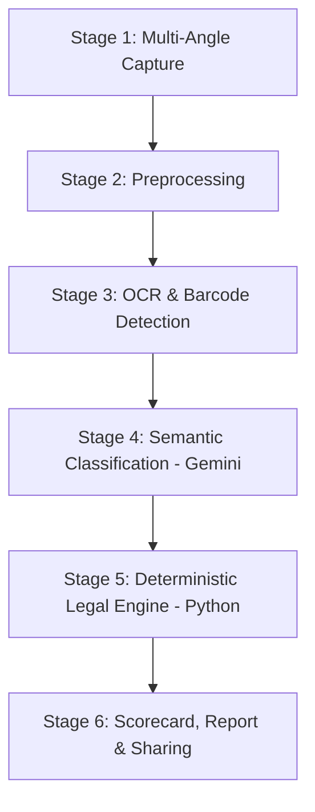

# 🔍 MetroScan: How It Works — From Scratch (Beginner's Complete Guide)

> **Welcome!** If you are opening this repository for the very first time and have zero prior knowledge about Legal Metrology, Computer Vision, or AI pipelines, **this document is written specifically for you.**
>
> By the end of this guide, you will understand:
> 1. What problem this project solves in real life.
> 2. What Indian laws mandate on every packet of chips, soap, or biscuits.
> 3. How MetroScan turns smartphone photos of packaging into legal inspection reports in seconds.
> 4. Why we combine **Generative AI** with a **Deterministic Python Rule Engine** (and why letting AI alone judge legality is dangerous).
> 5. What every single file in this project does.
> 6. How you can run and test it on your computer right now.

---

## Table of Contents
1. [The Real-World Problem: What is Legal Metrology?](#1-the-real-world-problem-what-is-legal-metrology)
2. [The Big Picture: What Does MetroScan Do?](#2-the-big-picture-what-does-metroscan-do)
3. [The Core Architectural Philosophy: AI vs. Deterministic Rules](#3-the-core-architectural-philosophy-ai-vs-deterministic-rules)
4. [The 6-Stage Pipeline (Step-by-Step Walkthrough)](#4-the-6-stage-pipeline-step-by-step-walkthrough)
   - [Stage 1: Multi-Angle Image Capture](#stage-1-multi-angle-image-capture)
   - [Stage 2: Image Preprocessing](#stage-2-image-preprocessing)
   - [Stage 3: On-Device OCR & Barcode Calibration](#stage-3-on-device-ocr--barcode-calibration)
   - [Stage 4: Semantic Extraction via Gemini AI](#stage-4-semantic-extraction-via-gemini-ai)
   - [Stage 5: Deterministic Legal Metrology Engine (Pure Python)](#stage-5-deterministic-legal-metrology-engine-pure-python)
   - [Stage 6: Scorecard, Legal Certificate & Distribution](#stage-6-scorecard-legal-certificate--distribution)
5. [The 10 Statutory Rules Explained in Plain English](#5-the-10-statutory-rules-explained-in-plain-english)
6. [How We Measure Physical Font Sizes in Millimeters From a Photo](#6-how-we-measure-physical-font-sizes-in-millimeters-from-a-photo)
7. [Trace Through a Real Example: The Karachi Bakery Box](#7-trace-through-a-real-example-the-karachi-bakery-box)
8. [Codebase Anatomy: File-by-File Tour](#8-codebase-anatomy-file-by-file-tour)
9. [How to Run and Test This Project Locally](#9-how-to-run-and-test-this-project-locally)
10. [Frequently Asked Questions (FAQ)](#10-frequently-asked-questions-faq)

---

## 1. The Real-World Problem: What is Legal Metrology?

Whenever you buy a packet of biscuits, a bottle of shampoo, a bag of rice, or mobile phone earphones in India, have you ever looked closely at the back of the packet?

You will notice small printed text containing:
- The Manufacturer’s Name and Full Address
- Net Quantity (e.g., `400 g` or `1 L`)
- Maximum Retail Price (`MRP ₹ 220.00 inclusive of all taxes`)
- Date of Packing / Manufacture (`08/2026`)
- Expiry Date / Best Before
- Customer Care Phone Number and Email Address
- Country of Origin (`Product of India` or `Made in China`)

These are not printed out of the kindness of the manufacturer’s heart. They are **strictly mandated by Indian federal law**:
- **The Legal Metrology Act, 2009**
- **The Legal Metrology (Packaged Commodities) Rules, 2011**

### The Enforcement Bottleneck Today
In India, over **100,000 packaged items are sold every single second**. 

State Legal Metrology officers (government inspectors) are tasked with visiting shops, supermarkets, and wholesale godowns to verify whether packaging follows these rules.
- **How inspectors work today:** They carry a **magnifying glass**, a **mechanical steel ruler**, and a **calculator**. They squint at tiny print, measure the physical height of letters in millimeters, calculate if the unit price is correct, and handwrite legal violation notices on paper.
- **The limitation:** A hardworking inspector can audit at most **15 to 25 packages in an entire 8-hour workday**.
- **The consequence:** Rampant consumer deception goes undetected:
  - Companies hide prices or omit *"inclusive of all taxes"* so retailers can overcharge.
  - Substandard font sizes ($< 1\text{ mm}$) hide critical warnings.
  - Customer care numbers are missing or fake.
  - Quantities use illegal, deceptive units like `"gms"` or non-metric pounds.

---

## 2. The Big Picture: What Does MetroScan Do?

**MetroScan** automates this entire manual audit process using a smartphone camera and intelligent software.

```
┌─────────────────────────┐
│  Physical Product Pack  │  (e.g., Biscuits, Oil, Noodles)
└───────────┬─────────────┘
            │  1. Snap photos with phone camera
            ▼
┌─────────────────────────┐
│    OCR Text Detection   │  (Extracts every word + 2D pixel coordinates)
└───────────┬─────────────┘
            │  2. Raw text lines + Bounding Boxes
            ▼
┌─────────────────────────┐
│   Semantic AI Parser    │  (Gemini organizes messy text into legal fields)
│   (Stage 4: Extraction) │  (Zero legal decisions made here!)
└───────────┬─────────────┘
            │  3. Clean Structured JSON
            ▼
┌─────────────────────────┐
│  Legal Metrology Engine │  (10 Pure-Python Rule Evaluators test against law)
│  (Stage 5: Rule Engine) │  (100% deterministic, zero hallucinations)
└───────────┬─────────────┘
            │  4. PASS / FAIL / UNCERTAIN Scorecard
            ▼
┌─────────────────────────────────────────────────────────┐
│   Instant Action & Tamper-Evident Legal PDF Report      │
│   • Download PDF directly to device                     │
│   • Share via WhatsApp / Email at zero API cost         │
│   • Real-time GIS Heatmap sync on Central Web Dashboard │
└─────────────────────────────────────────────────────────┘
```

Instead of an inspector spending 20 minutes inspecting one box with a ruler, **MetroScan performs the complete legal check in under 30 seconds**.

---

## 3. The Core Architectural Philosophy: AI vs. Deterministic Rules

This is the most important technical concept in the entire repository:

> ⚠️ **Why we NEVER ask an AI model like ChatGPT or Gemini: "Is this package legally compliant? Reply PASS or FAIL."**

### The Danger of Pure AI in Legal Compliance
Large Language Models (LLMs) are probabilistic neural networks. They predict the next most likely token. This creates severe risks in legal enforcement:
1. **Hallucination:** An LLM might say a packet passed even if the tax clause was missing, or fail a packet because it misread a date format.
2. **Non-determinism:** If you run the same photo 3 times through an LLM, you might get PASS, then FAIL, then PASS. A court of law or government tribunal will throw out evidence that is not 100% repeatable.
3. **Black Box:** An LLM cannot explain its mathematical proof down to the exact byte and millimeter.

### The MetroScan Hybrid Solution
We divide the problem cleanly into two different jobs:

| Task | Who Does It? | Why? |
| :--- | :--- | :--- |
| **Understanding Messy Text**<br>(e.g. knowing that `"Pkd by: XYZ Ind."` means Manufacturer) | **Gemini 3.6 Flash (AI)** | LLMs excel at understanding human linguistic variations, messy line breaks, and unstructured text. |
| **Deciding Legality (PASS / FAIL)**<br>(e.g. checking SI units, tax inclusion, font height) | **Deterministic Python Engine** | Code is 100% predictable, testable, verifiable, and legally admissible in court. |

**Rule of Thumb:**
- **Gemini's Job:** *"Find the words on the box and put them into structured labeled drawers."*
- **Python's Job:** *"Check if the contents of each drawer satisfy the exact text of the 2011 Rules."*

---

## 4. The 6-Stage Pipeline (Step-by-Step Walkthrough)

Let's follow a product from the moment the camera points at it to the final legal report.



---

### Stage 1: Multi-Angle Image Capture
Packaged goods are 3-dimensional objects (boxes, pouches, bottles). Manufacturers do not print all legal declarations on one side:
- **Front Panel (Principal Display Panel):** Brand Name, Net Quantity.
- **Back / Side Panel:** Manufacturer Address, Ingredients, Consumer Care.
- **Top / Bottom Flap:** Stamped MRP, Batch Number, Manufacturing Date, Expiry Date.

The mobile app guides the user to take **1 to 6 photos** capturing all faces of the packaging.

---

### Stage 2: Image Preprocessing
Raw smartphone photos are massive (12 to 50 megapixels) and often taken under bad lighting or tilted angles.
- **Downsampling:** The image is resized to an optimal $1920 \times 1080$ resolution. This reduces memory usage by 60% without losing character sharpness.
- **Grayscale & Contrast Enhancement:** Distracting colors are stripped; black text is separated from light backgrounds.
- **Deskewing:** Tilted text lines are rotated flat so OCR can read them accurately.

---

### Stage 3: On-Device OCR & Barcode Calibration
This stage runs locally on the mobile phone using **Google ML Kit**:
1. **What is OCR?** Optical Character Recognition scans pixels and detects letters, words, and numbers.
2. **What is a Bounding Box?** For every word detected, the OCR engine returns its exact 2D box coordinates:
   ```json
   {
     "text": "Net Quantity: 400g",
     "bounding_box": { "x": 245, "y": 380, "width": 180, "height": 24 }
   }
   ```
3. **Barcode Detection:** The scanner looks for an EAN-13 retail barcode. As explained in Section 6, this barcode gives us a real-world physical ruler!

*Result of Stage 3:* A raw JSON file like [`sampleinput.json`](file:///d:/desktop/Project/sihstage4and5/sampleinput.json) containing all detected words and their bounding boxes.

---

### Stage 4: Semantic Extraction via Gemini AI
Now we have dozens of disjointed text fragments:
- `"Karachi Bakery Pearl Pvt Ltd"`
- `"Net Qty: 400g"`
- `"MRP ₹ 220.00 (Incl. of all taxes)"`
- `"fssai 13618011000083"`

We send this lightweight text (just a few kilobytes) to **Gemini 3.6 Flash**.

We give Gemini a strict system instruction:
> *"Extract the 9 statutory fields from this OCR text into structured JSON. DO NOT judge compliance. DO NOT output PASS or FAIL. If a field is missing, set it to null."*

Gemini returns structured data:
```json
{
  "fields": {
    "manufacturer_packer_importer": "Karachi Bakery Pearl Pvt Ltd, Survey No 240...",
    "generic_common_name": null,
    "net_quantity": "400g",
    "manufacturing_packing_import_date": "PACKED ON: 26.AUG.2026",
    "mrp": "MRP in (₹): (Incl. of all taxes) 220.00",
    "best_before_expiry": "USE BY DATE : 25.JAN.2027",
    "consumer_care": "Customer Care No: +9140 66660909, Email: info@karachibakery.com...",
    "country_of_origin": "PRODUCT OF INDIA",
    "unit_sale_price": "USP . RS . 0.55/g"
  }
}
```

*Result of Stage 4:* Saved as [`sampleout.json`](file:///d:/desktop/Project/sihstage4and5/sampleout.json).

---

### Stage 5: Deterministic Legal Metrology Engine (Pure Python)
Now our pure Python engine ([`backend/legal_engine/engine.py`](file:///d:/desktop/Project/sihstage4and5/backend/legal_engine/engine.py)) takes over. 

It runs **10 independent statutory rule evaluators**, testing the structured fields against the exact legal requirements of the 2011 Rules. Zero internet connection or API calls are required here.

Each rule returns one of four statuses:
- **`PASS`**: Completely satisfies the statutory clause.
- **`FAIL`**: Explicitly violates the law or is missing a mandatory declaration.
- **`UNCERTAIN`**: Ambiguous, truncated, or uncalibrated (requires human manual check).
- **`NOT_APPLICABLE`**: The rule does not apply to this category (e.g., expiry date on earphones, or country of origin on domestic goods).

*Result of Stage 5:* Saved as [`compliance_result.json`](file:///d:/desktop/Project/sihstage4and5/compliance_result.json).

---

### Stage 6: Scorecard, Legal Certificate & Distribution
1. **Interactive Visual Scorecard:** The mobile app displays a color-coded scorecard:
   - Green Checkmarks for Compliant declarations.
   - Red Crosses for Violations.
   - Amber Badges for Warnings.
2. **Official Inspection Certificate (PDF):**
   - Automatically compiled on the phone.
   - Includes Inspector Badge ID, Geo-coordinates (GPS), timestamp, full 10-rule audit table, photos of the packaging, and a cryptographic **SHA-256 digital hash** to prevent tampering.
3. **Triple Distribution System:**
   - 📥 **Download PDF:** Saved directly into the phone's Downloads folder.
   - 📱 **Send via WhatsApp:** Opens WhatsApp with the PDF pre-attached.
   - 📧 **Send via Email:** Opens Gmail/Outlook with the PDF pre-attached.
   - *Cost:* **₹0.00** (uses native OS share intents without third-party SMS or email gateway fees).
4. **Central Cloud Sync:** The scan event syncs to Supabase, pinning the violation on the interactive national OpenStreetMap dashboard.

---

## 5. The 10 Statutory Rules Explained in Plain English

Here is the exact legal checklist evaluated by the Stage 5 engine:

| Rule ID | Statutory Name | What the Law Mandates | How MetroScan Validates It |
| :--- | :--- | :--- | :--- |
| **Rule 6(1)(a)** | Manufacturer / Packer / Importer | Must state the legal entity name and a complete physical address including street, city, state, and postal PIN code. | Checks address length ($>15$ chars), presence of geographical keywords, and 6-digit Indian PIN codes. |
| **Rule 6(1)(b)** | Generic / Common Commodity Name | Must state what the product actually is (e.g. *"Biscuits"*, *"Refined Sunflower Oil"*), not just a fancy marketing name like *"Crunchy Delight"*. | Verifies the field is not null and is distinct from mere brand slogans. |
| **Rule 6(1)(c)** | Net Quantity | Net contents stated strictly in standard SI metric units (`g`, `kg`, `ml`, `l`, `pcs`, `N`). | Uses regex to validate standard units; catches and flags illegal abbreviations like `"gms"`, `"kilos"`, or imperial `"oz"`. |
| **Rule 6(1)(d)** | Manufacturing / Packing Date | Month and year of manufacture or packing (`MM/YYYY` or Month Year). | Checks for valid month and 4-digit/2-digit year representations; rejects ambiguous batch codes. |
| **Rule 6(1)(e)** | Maximum Retail Price (MRP) | Retail price must include the exact phrase *"inclusive of all taxes"* or *"incl. of all taxes"*. | Validates numerical price and searches for the mandatory tax phrase; flags `FAIL` if tax inclusion is missing. |
| **Rule 6(1)(f)** | Best Before / Expiry Date | Mandatory for perishables (food, cosmetics, medicines). | Category-aware: Flags `FAIL` if missing on food/cosmetics; returns `NOT_APPLICABLE` for consumer electronics. |
| **Rule 6(1)(g)** | Consumer Care Details | Contact details of the grievance officer: Name, physical address, telephone number, and email address. | Checks for phone/toll-free numbers and valid email regex (`name@domain.com`). |
| **Rule 6(1)(h)** | Country of Origin | Mandatory for imported goods (e.g., *"Made in Vietnam"*, *"Country of Origin: Italy"*). | If product is imported, checks that origin country is declared; returns `NOT_APPLICABLE` for domestic goods. |
| **Rule 6(1)(i)** | Unit Sale Price (USP) | Price per standard unit (e.g., `₹0.55 / g` or `₹120 / L`) so consumers can compare value across pack sizes. | Verifies price per unit format. Mandatory for multi-packs and combo packs. |
| **Rule 6(3)** | Minimum Font & Numeral Height | Minimum character height based on Principal Display Panel area: $\le 100\text{ cm}^2 \rightarrow \ge 1\text{ mm}$; $100\text{–}500\text{ cm}^2 \rightarrow \ge 2\text{ mm}$, etc. | Measures bounding box height calibrated against the barcode to verify physical millimeter height. |

---

## 6. How We Measure Physical Font Sizes in Millimeters From a Photo

A camera captures images in **pixels**, not **millimeters**. 
- A letter might be 30 pixels tall on a high-resolution photo, but only 10 pixels tall on a low-resolution photo.
- How can software tell if a letter is physically $\ge 1.0\text{ mm}$ or $\ge 2.0\text{ mm}$ in real life?

### The Barcode Calibration Trick (GS1 Standards)
Every retail package in India carries a GS1 EAN-13 barcode:

```
      ||| | |||| || ||||| | ||
      8 908004 010850
      |<─── 37.29 mm ────>|
```

Under international GS1 manufacturing standards, a standard retail EAN-13 barcode has a **known, fixed physical width of 37.29 millimeters**.

When MetroScan detects the barcode in the camera image:
1. It measures the width of the barcode in pixels (e.g., $w = 373\text{ pixels}$).
2. It calculates the **Pixels-per-Millimeter Ratio**:
   $$\text{Pixels per Millimeter} = \frac{373\text{ pixels}}{37.29\text{ mm}} = 10.0\text{ px/mm}$$
3. Now, if the Net Quantity text has a bounding box height of $25\text{ pixels}$:
   $$\text{Physical Height} = \frac{25\text{ pixels}}{10.0\text{ px/mm}} = 2.5\text{ mm}$$
4. Since $2.5\text{ mm} \ge 2.0\text{ mm}$ (statutory threshold), the font size legally **PASSES**!

---

## 7. Trace Through a Real Example: The Karachi Bakery Box

Let's look at the actual sample dataset included in this project:

### 1. The Input ([`sampleinput.json`](file:///d:/desktop/Project/sihstage4and5/sampleinput.json))
A real biscuit box from Karachi Bakery was photographed and run through OCR. The OCR output contains 16 detections:
- `det_001`: `"(DD). Karachi bakery Pearl Pvt Limited"`
- `det_002`: `"Survey No 240, Shed No.4... PIN-500030"`
- `det_008`: `"Net Quantity:"`
- `det_009`: `"400g"`
- `det_010`: `"MRP in (₹):"`
- `det_011`: `"(Incl. of all taxes) 220.00"`
- `det_013`: `"PACKED ON:"`
- `det_014`: `"26.AUG.2026"`
- `det_015`: `"USE BY DATE :"`
- `det_016`: `"25.JAN.2027"`
- `det_006`: Consumer Care contact phone (`+9140 66660909`) and email (`info@karachibakery.com`).
- `det_007`: `"PRODUCT OF INDIA"`
- `det_011`: `"USP . RS . 0.55/g"`

### 2. The Extraction ([`sampleout.json`](file:///d:/desktop/Project/sihstage4and5/sampleout.json))
Gemini maps these detections into standard fields. Notice:
- `generic_common_name` was not detected on this back label, so Gemini correctly sets it to `null`.

### 3. The Legal Evaluation ([`compliance_result.json`](file:///d:/desktop/Project/sihstage4and5/compliance_result.json))
When [`backend/run_stage5.py`](file:///d:/desktop/Project/sihstage4and5/backend/run_stage5.py) runs on this data:
```
OVERALL STATUS  : FAIL
COMPLIANCE SCORE : 80.0 / 100.0
SUMMARY         : Total: 10 | Passed: 8 | Failed: 1 | Uncertain: 1 | N/A: 0

RULE 6(1)(a) : [PASS]      - Valid manufacturer address found with PIN-500030.
RULE 6(1)(b) : [FAIL]      - Generic or common commodity name is missing!
RULE 6(1)(c) : [PASS]      - Net quantity declared as 400 g.
RULE 6(1)(d) : [PASS]      - Packed date declared as AUG.2026.
RULE 6(1)(e) : [PASS]      - MRP declared as ₹ 220.00 (inclusive of all taxes).
RULE 6(1)(f) : [PASS]      - Expiry declared as USE BY DATE : 25.JAN.2027.
RULE 6(1)(g) : [PASS]      - Consumer care declared with phone and email.
RULE 6(1)(h) : [PASS]      - Declared as PRODUCT OF INDIA.
RULE 6(1)(i) : [PASS]      - Declared as USP . RS . 0.55/g.
RULE 6(3)    : [UNCERTAIN] - Barcode reference was not in this specific OCR file.
```

**Why is Overall Status `FAIL`?**
Because under Indian law, every mandatory rule must pass. Missing the generic commodity name (Rule 6(1)(b)) is a statutory non-compliance. MetroScan correctly flagged this violation with 100% precision!

---

## 8. Codebase Anatomy: File-by-File Tour

Here is where everything lives in the folder structure:

```
sihstage4and5/
├── backend/
│   ├── extractors/
│   │   ├── gemini_extractor.py      # Client that calls Gemini 3.6 Flash
│   │   └── prompt.py                # Strict system instructions & JSON schema for AI
│   ├── legal_engine/
│   │   ├── rules/                   # The 10 individual statutory rule evaluators
│   │   │   ├── rule_6_1_a.py        # Manufacturer & Address check
│   │   │   ├── rule_6_1_b.py        # Generic Name check
│   │   │   ├── rule_6_1_c.py        # Net Quantity SI unit check
│   │   │   ├── rule_6_1_d.py        # Mfg / Packing Date check
│   │   │   ├── rule_6_1_e.py        # MRP & "inclusive of all taxes" check
│   │   │   ├── rule_6_1_f.py        # Best Before / Expiry check
│   │   │   ├── rule_6_1_g.py        # Consumer Care phone/email check
│   │   │   ├── rule_6_1_h.py        # Country of Origin check
│   │   │   ├── rule_6_1_i.py        # Unit Sale Price check
│   │   │   └── rule_6_3.py          # Font & Numeral Height millimeter calculation
│   │   ├── engine.py                # Main orchestrator: runs all 10 rules, computes score
│   │   ├── models.py                # Pydantic data schemas (RuleEvaluation, EvidenceItem)
│   │   └── normalization.py         # Regex helpers for units, prices, emails, PIN codes
│   ├── tests/
│   │   └── test_legal_engine.py     # 33 unit tests validating edge cases (runs offline)
│   ├── main.py                      # FastAPI REST server exposing /api endpoints
│   ├── run_sample.py                # Full live pipeline runner (AI extraction + legal rules)
│   ├── run_stage5.py                # Offline legal runner (no API key needed)
│   ├── test_connection.py           # Quick sanity test for Gemini API connectivity
│   └── config.py                    # Environment variables & constants
│
├── frontend/
│   └── index.html                   # Web testing interface
│
├── test_samples/                    # Benchmark test cases (chips, salt, combo packs, etc.)
│   ├── sample_02_maggi_noodles.json
│   ├── sample_04_ferrero_imported.json
│   ├── sample_05_parle_g_missing_tax.json
│   └── ...
│
├── sampleinput.json                 # Active input contract (raw OCR data)
├── sampleout.json                   # Extraction output contract (structured semantic data)
├── compliance_result.json           # Legal evaluation output (final 10-rule scorecard)
├── congigation_data.json            # Consolidated product dossier (Input + AI + Legal result)
└── SIH_COMPREHENSIVE_GUIDE.md       # Original hackathon reference guide
```

---

## 9. How to Run and Test This Project Locally

You can test this project right now on your computer. Follow these steps:

### Step 1: Run the 33 Offline Unit Tests
You don't need an API key or internet connection to test the Legal Engine. Run:

```bash
python -m unittest backend/tests/test_legal_engine.py
```
**Expected Output:**
```text
.................................
----------------------------------------------------------------------
Ran 33 tests in 0.005s

OK
```
*(All 33 tests pass in under 10 milliseconds!)*

---

### Step 2: Run the Offline Legal Verification Runner
To evaluate the sample product (`sampleout.json` + `sampleinput.json`) using pure Python logic:

```bash
python backend/run_stage5.py sampleout.json sampleinput.json
```
This prints the formatted 10-rule compliance table to your terminal and updates [`compliance_result.json`](file:///d:/desktop/Project/sihstage4and5/compliance_result.json).

---

### Step 3: Run the Full End-to-End Pipeline (With Gemini)
If you have a Google Gemini API Key:
1. Open [`backend/.env`](file:///d:/desktop/Project/sihstage4and5/backend/.env) and set your key:
   ```env
   GEMINI_API_KEY="your_actual_gemini_api_key_here"
   ```
2. Test the connection:
   ```bash
   python backend/run_sample.py --test-connection
   ```
3. Run the live pipeline on any input dataset:
   ```bash
   python backend/run_sample.py sampleinput.json
   ```
This will:
- Send OCR text to Gemini 3.6 Flash.
- Save structured output to `sampleout.json`.
- Run the 10 Legal Metrology rules.
- Save results to `compliance_result.json` and consolidated dossier to `congigation_data.json`.

---

### Step 4: Start the FastAPI Web Server
To launch the backend server:

```bash
python -m uvicorn backend.main:app --reload --port 8000
```
- Open your browser to: `http://localhost:8000`
- Check API docs at: `http://localhost:8000/docs`

---

## 10. Frequently Asked Questions (FAQ)

#### Q1: What happens if an inspector is in a remote village or basement with no internet?
The OCR engine (Google ML Kit) runs 100% on the mobile device's chip. The Legal Metrology rule engine (Stage 5) runs 100% offline in pure code. If there is no internet, the app performs the audit locally, saves the report to the phone's encrypted storage, and automatically syncs to the cloud once network returns.

#### Q2: What if the packaging is slightly wrinkled or torn?
Our prompt engineering in Stage 4 instructs Gemini to perform fuzzy linguistic recovery on broken words (e.g. recognizing `"Mfd by"` even if the `"M"` is partially cut). If text is too corrupted to be confident, the rule engine marks the field as `UNCERTAIN`, prompting the inspector to verify that specific field manually.

#### Q3: Why is an incomplete address flagged as `UNCERTAIN` instead of `FAIL`?
If an address is present but lacks a street name or PIN code, marking it `FAIL` might lead to unfair penalties against small local producers. Marking it `UNCERTAIN` alerts the field inspector to take a second closer photograph before issuing an official penalty notice.

#### Q4: Why is report distribution done via the phone's native share sheet?
Commercial SMS and WhatsApp Business APIs require expensive per-message fees and complex template approvals. By using Flutter's native `share_plus` library, MetroScan opens the operating system's native share dialog. The inspector can tap WhatsApp, Gmail, or Bluetooth to send the PDF directly from their personal or government phone at **zero API cost**.

---

*Document compiled for the MetroScan Project — Smart India Hackathon (SIH).*
